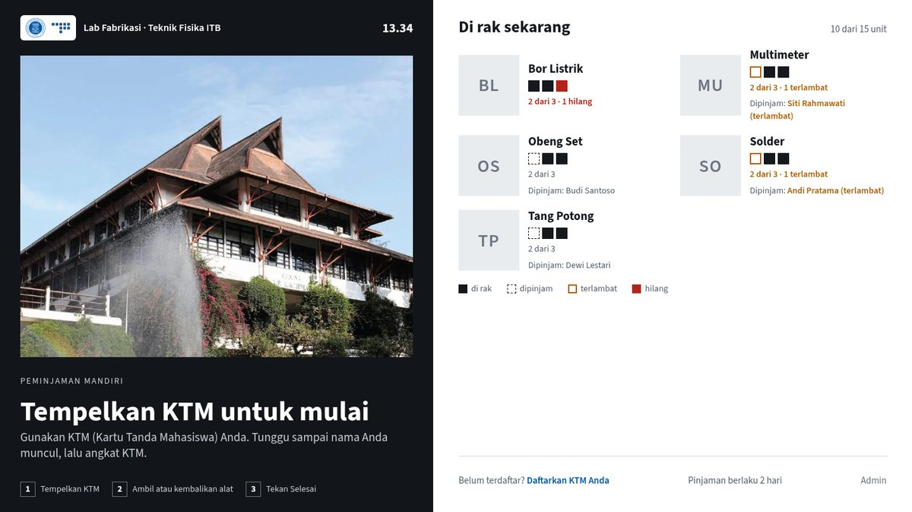
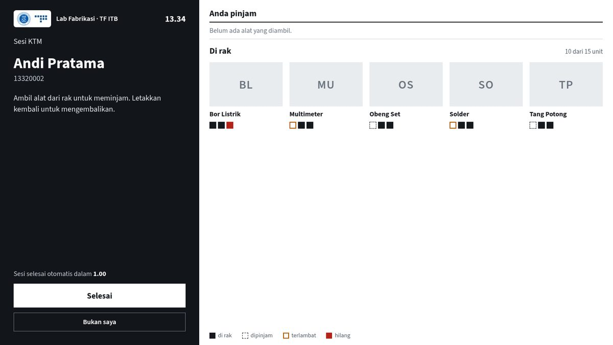
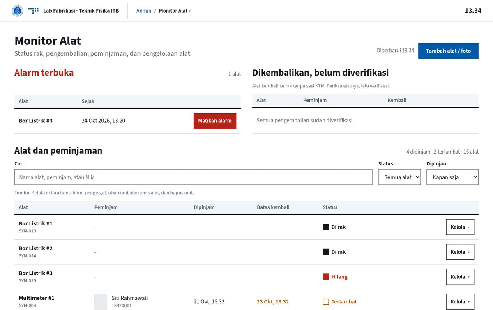
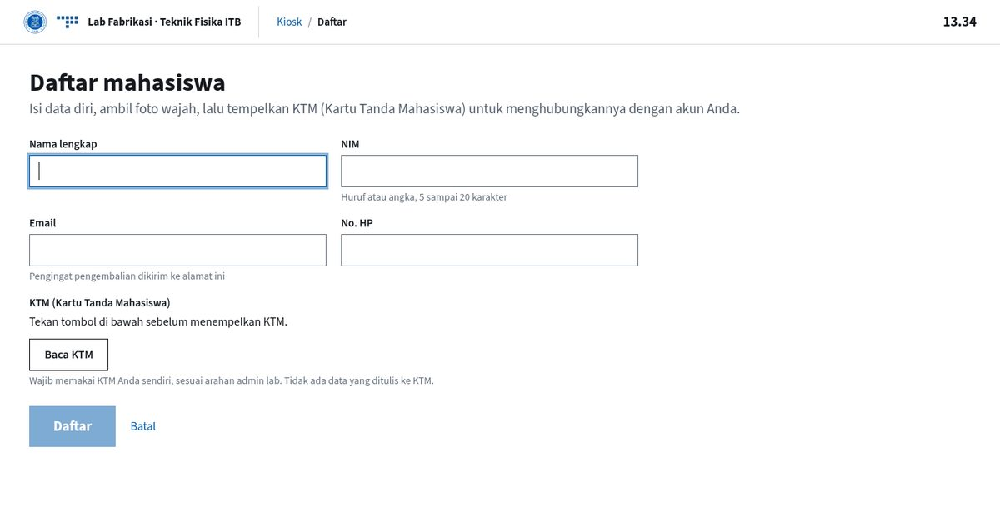
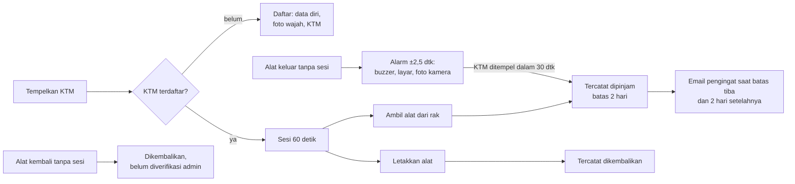

<p align="center"></p>

# Lab Fabrikasi TF ITB — Kiosk Peminjaman Alat

Kiosk peminjaman alat workshop Lab Fabrikasi Teknik Fisika ITB. Mahasiswa membuka sesi dengan **KTM (Kartu Tanda Mahasiswa)**. Setiap alat diberi tag UHF RFID yang terus dipantau reader: alat yang diambil saat sesi tercatat sebagai pinjaman, sedangkan alat yang keluar tanpa sesi memicu alarm. Admin mengelola semuanya di layar yang sama, dengan login wajah atau PIN.

**Untuk siapa README ini:** tim dan penerus pengelola lab yang akan menjalankan, merawat, atau mengembangkan kiosk ini.

| Kiosk menunggu KTM | Sesi peminjaman |
|---|---|
|  |  |
| **Admin: Monitor Alat** | **Daftar mahasiswa** |
|  |  |

<sub>Screenshot memakai data contoh, bukan data mahasiswa asli.</sub>

## Cara kerja



- **Kiosk** (`/kiosk`): papan "Di rak sekarang" menampilkan tiap alat, siapa peminjamnya, dan yang terlambat atau hilang.
- **Daftar** (`/daftar`): isi data, ambil foto wajah (hitungan mundur 3-2-1 dengan bunyi buzzer), lalu tempelkan KTM.
- **Admin** (`/admin`, tautan "Admin" di kanan bawah kiosk): ringkasan, alat (alarm, verifikasi pengembalian, kelola unit), mahasiswa, keamanan (foto alarm, kamera tertutup, wajah admin, riwayat login), tambah alat, riwayat dan ekspor (CSV/Excel/email) serta riwayat email pengingat. Pindah halaman lewat nama halaman ▾ di bar atas; aksi per baris lewat tombol **Kelola ▾**.

## Perangkat

| Bagian | Model | Catatan |
|---|---|---|
| Komputer | NVIDIA Jetson Nano 4GB | JetPack 4.6.1, Ubuntu 18.04, Python 3.8, OpenCV 5.0 (CPU) |
| Reader alat | HW-VX6336 UHF RFID (USB serial) | Jangkauan 0–20 cm, `/dev/rfid-reader` |
| Reader KTM | PN532 NFC (I²C, alamat 0x24) | |
| Kamera | Webcam USB | Foto daftar, login wajah admin, foto alarm |
| Layar | Monitor + mouse + keyboard USB | Chromium mode kiosk |

Aplikasi hanya terbuka di `127.0.0.1:5000` pada Jetson itu sendiri; tidak bisa diakses dari perangkat lain.

## Menjalankan di laptop

Butuh Python 3.8+.

```bash
./setup.sh                                     # .venv, dependensi, .env dari .env.example
.venv/bin/pip install -r requirements-cv.txt   # opsional: kamera dan wajah
.venv/bin/python scripts/fetch_face_models.py  # opsional: model wajah (hash dicek)
.venv/bin/python seed_database.py              # data contoh: mahasiswa + 5 jenis alat
.venv/bin/python app.py                        # http://localhost:5000/kiosk
```

Tanpa reader dan kamera (bawaan `.env.example`), jalankan dengan `FLASK_ENV=development` lalu `scripts/kiosk_demo.sh` untuk memutar semua keadaan kiosk: tag di rak, sesi, pinjam, selesai, alarm.

**Tes:** `scripts/check.sh` (ruff + pytest). Kode harus tetap jalan di Python 3.8; `PY38=<python3.8> scripts/check.sh` juga menjalankan tes di 3.8.

## Deploy ke Jetson

Setiap deploy lewat tag Git supaya tercatat:

```bash
git tag -a v2026.10.24.18 -m v2026.10.24.18   # format vYYYY.MM.DD[.N]
git push origin main v2026.10.24.18
scripts/deploy_jetson.sh v2026.10.24.18
```

`deploy_jetson.sh` menjalankan `deploy/jetson/update.sh` milik tag itu di Jetson: pytest di salinan staging, backup kode dan database ke `~/tpt-deploys/`, checkout, reload gunicorn, cek kesehatan, dan rollback otomatis kalau gagal. Jangan menyalin kode dengan rsync.

Pemasangan pertama di Jetson baru: [deploy/jetson/README.md](deploy/jetson/README.md) (`install.sh`, coba dulu dengan `DRY_RUN=1`). Script ini memasang service systemd, backup harian 03:00, udev rule reader, autostart kiosk, dan ikon **Lab Fabrikasi** di desktop.

## Konfigurasi

Semua di `.env`; lihat [`.env.example`](.env.example). Yang paling sering disentuh:

| Variabel | Bawaan | Keterangan |
|---|---|---|
| `FLASK_ENV` / `SECRET_KEY` | `development` / – | `production` dan kunci acak di Jetson |
| `ADMIN_PIN_HASH` | – | Diisi oleh `scripts/set_admin_pin.py`. Tanpa ini PIN bawaan `133133` berlaku |
| `RFID_READER_ENABLED`, `NFC_READER_ENABLED`, `CAMERA_ENABLED` | `false` | `true` di Jetson; `false` memakai tiruan (mock) |
| `RFID_MISSING_AFTER` | `1.5` | Detik tag tak terbaca sebelum alat dianggap keluar rak |
| `RFID_ALARM_CONFIRM_SECONDS` | `1` | Jeda tambahan sebelum alarm, menahan alarm palsu |
| `ALARM_GRACE_SECONDS` / `ALARM_OVERLAY_SECONDS` | `30` / `30` | Batas waktu KTM mengubah alarm jadi pinjaman / lama overlay alarm di layar |
| `KIOSK_SESSION_SECONDS` | `60` | Lama sesi KTM (bertambah saat ada alat diambil/dikembalikan) |
| `MAIL_USERNAME` / `MAIL_PASSWORD` | – | Gmail lab + App Password 16 huruf |
| `LOAN_REMINDERS_ENABLED` | `false` | Email otomatis saat batas pinjam tiba dan 2 hari setelahnya |
| `FACE_LOGIN_ENABLED` | `false` | Login wajah admin (hanya di layar kiosk) |
| `FACE_RECOGNIZER` / `FACE_LIVENESS_MODELS` | `arcface_mbf` / `mn3:0.5` | Model pengenal wajah dan cek keaslian |

## Arsitektur

Flask 3 + SQLite (Flask-SQLAlchemy), template Jinja, CSS dan JavaScript tanpa framework, semua aset lokal (jalan offline). Gunicorn 1 worker 4 thread di belakang systemd; tabel baru ditambahkan lewat `create_all` (tidak ada migrasi kolom).

| Path | Isi |
|---|---|
| `app.py` | Membangun app (config, reader, kamera, layanan) + route halaman dan API lama |
| `routes/` | Blueprint: kiosk, admin, NFC, foto daftar, login wajah, keamanan, PWA |
| `utils/models.py`, `utils/database_handler.py` | Tabel dan semua query |
| `utils/vx6336.py`, `utils/rfid_reader.py` | Protokol dan reader UHF (mock/asli), buzzer |
| `utils/presence.py`, `utils/tool_presence.py` | Alat di rak / keluar, alarm |
| `utils/kiosk.py` | State machine sesi kiosk |
| `utils/nfc_reader.py`, `utils/nfc_service.py` | Reader KTM (PN532) |
| `utils/camera.py`, `utils/security.py` | Kamera, foto alarm, deteksi kamera tertutup |
| `utils/photo_capture.py` | Foto wajah saat daftar (YuNet, hitungan mundur + buzzer) |
| `utils/admin_face.py`, `utils/face.py`, `utils/liveness.py` | Login wajah admin |
| `utils/loan_reminders.py` | Email pengingat dan riwayatnya |
| `templates/`, `static/` | Halaman; `templates/<halaman>.html` berpasangan dengan `static/js/<halaman>.js` |
| `deploy/jetson/` | Instalasi dan update perangkat |
| `scripts/` | Deploy, PIN, model wajah, uji reader, bench anti-spoof |

Data mahasiswa dan alat yang dihapus hanya disembunyikan (*soft delete*); riwayat peminjaman tetap utuh.

## Runbook

**Ganti PIN admin.** Di terminal Jetson (ketik sendiri, jangan dibagikan):
```bash
cd ~/tpt-rfid && .venv/bin/python scripts/set_admin_pin.py
kill -HUP $(systemctl show -p MainPID --value tpt-rfid)
```

**Daftarkan wajah admin.** Di layar kiosk: Admin → login PIN → Keamanan → Wajah admin → isi nama → Daftarkan wajah → lihat kamera saat hitungan 3-2-1. Lalu Keluar dan coba "Masuk dengan wajah".

**Alarm berbunyi.** Kembalikan alat ke rak, atau peminjam menempelkan KTM dalam 30 detik. Kalau alarm palsu, admin menekan **Matikan alarm** di Monitor Alat. Foto saat alarm ada di Keamanan.

**Hapus mahasiswa atau alat.** Mahasiswa/Alat → Kelola ▾ → Hapus. Ditolak kalau masih ada pinjaman aktif. Mahasiswa yang mendaftar lagi dengan NIM sama dipulihkan datanya.

**Kirim email uji.** Di Jetson: `MAIL_LIVE_TO=alamat@contoh.com .venv/bin/python -m pytest -q tests/test_mail_live.py`.

**Kiosk tertutup.** Klik dua kali ikon **Lab Fabrikasi** di desktop Jetson.

**Kalibrasi cek keaslian wajah.** Di Jetson jalankan `scripts/face_spoof_bench.py real`, `print`, `screen`, lalu `--report`, kemudian atur `FACE_LIVENESS_MODELS`.

## Troubleshooting

**Tampilan kiosk tidak berubah setelah deploy**
Penyebab: cache browser. Perbaikan: Ctrl+Shift+R di kiosk.

**"Pembaca KTM tidak terhubung" atau alat tidak terbaca**
Cek `curl -s 127.0.0.1:5000/api/devices/status` di Jetson; cabut-pasang USB reader. Log: `journalctl -u tpt-rfid -n 100`.

**Login wajah sering ditolak**
Login log di Keamanan mencatat alasannya, dan `journalctl` mencatat jarak kemiripan. Daftarkan ulang wajah dengan cahaya yang sama; ambang di `FACE_MATCH_THRESHOLD`. PIN selalu bisa dipakai.

**Email pengingat masuk Spam**
Tandai "Bukan spam" sekali di kotak masuk penerima. Riwayat kirim ada di Riwayat → Email pengingat.

**Ikon desktop muncul sebagai file teks**
Klik kanan → Allow Launching, atau login ulang.

## Dokumen terkait

- [deploy/jetson/README.md](deploy/jetson/README.md) — pemasangan perangkat; [deploy/jetson/NFC_ROLLOUT.md](deploy/jetson/NFC_ROLLOUT.md) — peralihan ke KTM
- [`AGENTS.md`](AGENTS.md) — aturan kerja kode dan agen
- `.claude/knowledge/` — platform target, reader VX6336, model wajah dan riset anti-spoofing
- [docs/hardware](docs/hardware) — manual reader

## Lisensi

MIT License, Lab Fabrikasi Teknik Fisika ITB. Model wajah memakai lisensinya masing-masing: YuNet/SFace (Apache-2.0), anti-spoof-mn3 (MIT), MiniFASNet (Apache-2.0), dan ArcFace `w600k_mbf` dari InsightFace yang **hanya untuk riset non-komersial** (ganti ke `FACE_RECOGNIZER=sface` kalau dipakai komersial).

<sub>Terakhir ditinjau: 24 Oktober 2026.</sub>
